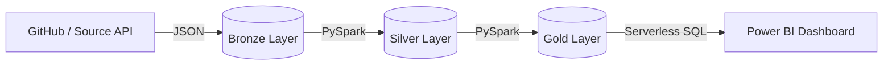

# 🛒 Azure Retail Data Engineering Pipeline

## 📌 Project Overview
This project is an end-to-end data engineering pipeline that ingests raw retail transaction data, cleanses it, and transforms it into business-level metrics for visualization. It utilizes the **Medallion Architecture (Bronze, Silver, Gold)** hosted on **Azure Data Lake Storage Gen2** and processed using **Azure Synapse Analytics**. The final curated data is connected to **Power BI** to build an interactive dashboard for daily revenue and sales tracking.

## 🏗️ Architecture

## 🛠️ Tech Stack & Azure Resources
*   **Storage:** Azure Data Lake Storage Gen2 (Hierarchical Namespace enabled)
*   **Compute / Processing:** Azure Synapse Analytics (Apache Spark Pools for PySpark)
*   **Serving / Querying:** Azure Synapse Serverless SQL Pool (T-SQL)
*   **Security:** Azure IAM, POSIX ACLs, Managed Identities, Database Scoped Credentials
*   **Visualization:** Power BI Desktop
*   **Ingestion:** Synapse Pipelines (Copy Data Tool)

## 📊 The Data Pipeline (Medallion Architecture)

### 1. Bronze Layer (Raw Data)
*   **Action:** Ingested raw `retail_transactions_bronze.json` via HTTP/Copy Data.
*   **Format:** JSON.
*   **Purpose:** Serves as an immutable historical record of the raw data. Data is stored exactly as it arrived from the source system.

### 2. Silver Layer (Cleaned & Conformed Data)
*   **Action:** Processed raw JSON using **PySpark** in a Synapse Notebook.
*   **Transformations Applied:**
    *   Filtered out non-revenue events (e.g., `cancel` and `refund`).
    *   Handled missing/empty `customer_id` values.
    *   Converted `event_timestamp` (String) to `event_date` (Date).
    *   Standardized `payment_method` to lowercase.
    *   Cast `amount` to Float type.
*   **Format:** Parquet.
*   **Why Parquet?** Parquet is a columnar storage format that offers high compression and lightning-fast read performance for analytical queries compared to raw JSON.

### 3. Gold Layer (Curated Business Data)
*   **Action:** Aggregated Silver data using PySpark.
*   **Transformations Applied:** Grouped by `event_date` to calculate `daily_revenue` (sum of amounts) and `total_purchases` (count of transactions).
*   **Format:** Parquet.

## 🔐 Security & Governance Implemented
Connecting cloud services securely is a major part of this project. The following security measures were implemented:
1.  **IAM Role Assignments:** Assigned `Storage Blob Data Contributor` to the Synapse Workspace's Managed Identity to allow secure read/write access to the Data Lake.
2.  **POSIX ACLs:** Configured Access Control Lists on the Data Lake Gen2 directories to ensure folder-level access.
3.  **Managed Identities in SQL:** Created a `DATABASE SCOPED CREDENTIAL` using the Workspace's Managed Identity to allow Serverless SQL to authenticate with the Storage Account without exposing passwords.

## 📈 Visualization (Power BI)
Connected Power BI Desktop to the Synapse Serverless SQL Endpoint using SQL Authentication. 
*   Created a `VIEW` using `OPENROWSET` to query the Gold Parquet files directly.
*   Built a dashboard featuring:
    *   **KPI Cards:** Total Revenue and Total Purchases.
    *   **Line Chart:** Revenue trends over time.
    *   **Column Chart:** Daily purchase volumes.
    *   **Slicer:** Date range filtering.

## 🚀 How to Replicate
1.  Deploy an Azure Data Lake Storage Gen2 account and a Synapse Workspace.
2.  Create `bronze`, `silver`, and `gold` folders inside a `retail` container.
3.  Use the Copy Data tool to ingest the JSON file into the Bronze folder.
4.  Run the `silver_notebook.py` and `gold_notebook.py` scripts in Synapse Studio using an Apache Spark pool.
5.  Execute the `create_external_tables.sql` script in the Serverless SQL pool to create the database, credential, and view.
6.  Connect Power BI to the Serverless SQL endpoint.

## 🧹 Resource Cleanup
To prevent ongoing Azure billing, all resources were deployed inside a single Resource Group (`DataEngineeringProject`). The entire resource group was deleted upon project completion.

---
*Created as part of an Azure Data Engineering portfolio.*
